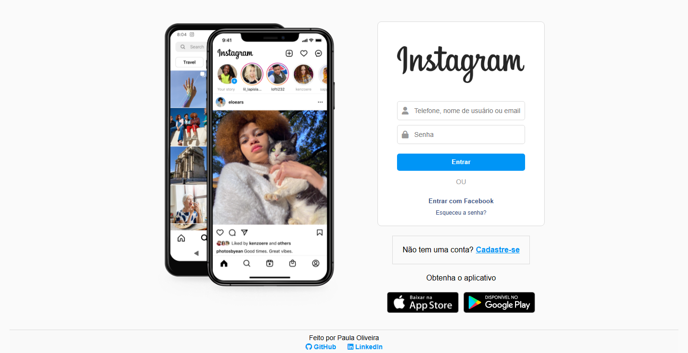

# 📸 Instagram UI Clone

<p align="center">
  
</p>

<p align="center">
  <strong>Recriação de interface com HTML, CSS e JavaScript.</strong>
  <br>
  Projeto educacional desenvolvido para praticar desenvolvimento Front-end, responsividade e interatividade.
</p>

<p align="center">
  <a href="https://paulapsox.github.io/login-instagram/">🌐 Acessar demonstração</a>
  ·
  <a href="https://github.com/paulaPSOx/login-instagram">📂 Repositório</a>
</p>

<p align="center">
  
  
  
  
</p>

---

## 📖 Sobre o projeto

O **Instagram UI Clone** é um projeto de estudo de interface inspirado na página de login do Instagram, desenvolvido com HTML5, CSS3 e JavaScript puro, sem frameworks.

O objetivo é reproduzir elementos visuais da interface e explorar conceitos fundamentais do desenvolvimento web, incluindo organização de código, estilização, responsividade, manipulação do DOM e eventos JavaScript.

**Importante:** este projeto é exclusivamente educacional e não é afiliado à Meta ou ao Instagram. Não implementa autenticação real.

## ✨ Funcionalidades

- 🖥️ Interface inspirada na página de login do Instagram.
- 📱 Layout responsivo para diferentes tamanhos de tela.
- 🎞️ Slideshow automático de imagens.
- 🎨 Estilização com CSS, variáveis personalizadas e transições.
- 💥 Animação de feedback visual para validação.
- 🔘 Botões com interações demonstrativas.
- 💬 Mensagens que indicam as ações simuladas.
- 🧩 Ícones utilizando Font Awesome.

## 🔐 Segurança e privacidade

Este projeto funciona exclusivamente no navegador e tem finalidade demonstrativa.

- Não possui integração com os sistemas de autenticação do Instagram ou do Facebook.
- Não envia credenciais para servidores.
- Não implementa recuperação real de senha nem cadastro de usuários.
- As interações são simulações de interface.

**Não insira senhas verdadeiras, dados pessoais ou credenciais de contas reais.** O projeto não deve ser utilizado como página de autenticação.

## 🛠️ Tecnologias utilizadas

| Tecnologia | Aplicação |
|---|---|
| HTML5 | Estrutura e semântica da página |
| CSS3 | Layout, responsividade, animações e estilos |
| JavaScript (ES6+) | Eventos, manipulação do DOM e interações |
| Font Awesome 6 | Ícones da interface |
| Git e GitHub | Versionamento e hospedagem do código |
| GitHub Pages | Publicação da demonstração |

## 📱 Responsividade

A interface utiliza Flexbox, unidades flexíveis e media queries para adaptar o conteúdo a diferentes resoluções.

- **Desktop:** apresentação do layout com a área de imagens e o formulário.
- **Tablet:** ajustes de espaçamento e dimensões dos componentes.
- **Mobile:** priorização do formulário, redução de espaçamentos e adaptação dos elementos.
- **Telas pequenas:** ajustes de largura, tipografia e áreas interativas.

A experiência pode variar conforme a resolução, o navegador e as imagens utilizadas.

## 📂 Estrutura do projeto

```text
login-instagram/
├── index.html
├── style.css
├── scripts.js
├── img/
│   ├── icone.png
│   ├── celular.png
│   ├── insta1.png
│   ├── insta2.png
│   ├── insta-logo.png
│   ├── ios.png
│   └── google.png
├── img-proj-login-instagram.png
└── README.md
```

> A estrutura acima representa a organização esperada dos arquivos. Confira os nomes e caminhos no repositório para garantir que correspondam aos arquivos existentes.

## 🚀 Como executar localmente

### 1. Clone o repositório

```bash
git clone https://github.com/paulaPSOx/login-instagram.git
```

### 2. Acesse a pasta do projeto

```bash
cd login-instagram
```

### 3. Abra a página

Abra o arquivo `index.html` no navegador ou utilize a extensão Live Server no Visual Studio Code para executar o projeto durante o desenvolvimento.

Não é necessário instalar dependências ou configurar um servidor de autenticação.

## 📚 Aprendizados

Durante o desenvolvimento, são praticados conceitos como:

- Estruturação de páginas com HTML semântico.
- Organização e reutilização de estilos com CSS.
- Criação de layouts responsivos com Flexbox e media queries.
- Manipulação de elementos e eventos com JavaScript.
- Implementação de animações e transições.
- Organização de arquivos e publicação de projetos front-end.

## 🎯 Objetivo

Desenvolver habilidades práticas em desenvolvimento Front-end por meio da recriação de uma interface conhecida, com atenção à responsividade, à experiência do usuário e à organização do código.

## 👩‍💻 Autora

**Paula Oliveira**

Desenvolvedora em formação, com interesse em desenvolvimento web, interfaces responsivas e criação de experiências digitais.

- 💻 GitHub: [@paulaPSOx](https://github.com/paulaPSOx)
- 💼 LinkedIn: [Paula Oliveira](https://www.linkedin.com/in/oliveiraspaula/)

---

<p align="center">
  Desenvolvido com 💙 para praticar e evoluir em Front-end.
</p>
